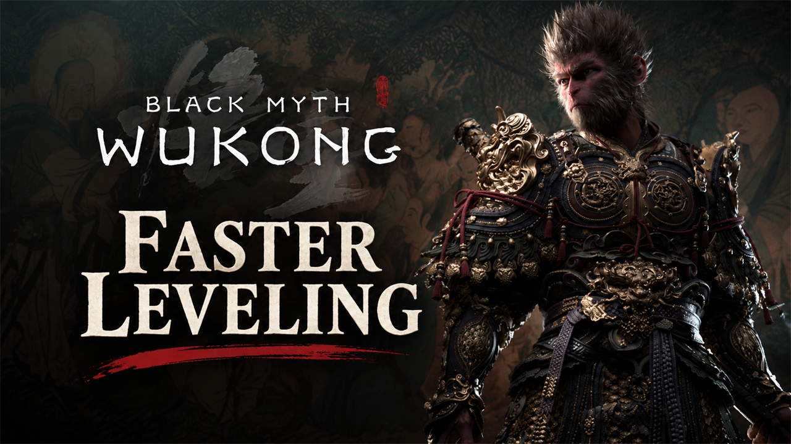

# Faster Leveling

Levels come twice as fast: every level needs half the XP, from level 1 up to the max level 342. Talent points per level stay as in the game.

## What it does

Every level needs half the XP it needs in the game. You gain XP as usual (enemies, bosses, everything else), so you
reach each level twice as fast.

| Level | XP for the next level in the game | With the mod |
|---|---|---|
| 1 | 342 | 171 |
| 10 | 814 | 407 |
| 50 | 4,416 | 2,208 |
| 100 | 11,848 | 5,924 |
| 200 | 19,898 | 9,949 |
| 342 | 38,912 | 19,456 |
| Level 1 to 342 in total | 5,878,823 | 2,939,489 |

- Odd values are rounded up, so a level never costs less than half.
- Each level still gives 1 talent point, and the max level stays the same. Enemies, XP drops and New Game+ are not
  changed.

## Screenshots

## How to install

1. Download the zip of the latest release on GitHub (`wukong_fasterleveling_<version>.zip`).
2. Open the game folder `b1\Content\Paks\`. If it has no folder `~mods`, create it.
3. Unpack `wukong_fasterleveling_P.pak` from the zip into `b1\Content\Paks\~mods\`.
4. Add the launch option `-fileopenlog`: in Steam, right-click the game, Properties, General, Launch Options.
   Without it the game does not load mods from `~mods`.
5. Start the game.

To update the mod, replace the file with the one of the new release. To remove it, delete the file; the launch option
can stay.

## How to use

Nothing to do: the mod works as soon as you load a game.

- With a save that already has XP toward the next level, that XP counts against the new, lower amount: you may level
  up at your next XP gain.
- Levels you gain stay in your save when you remove the mod.

## Compatibility

- Game version: 1.0.21 (`1.0.21.23831`).
- The mod replaces one game table: `PlayerLevelDesc` (the XP per level). A mod that replaces the same table conflicts
  with this one; only one of them works. Mods that change enemies or drops work next to it.
- A game update that changes this table needs a new build of the mod. Until then, the mod puts the older version of
  the table back; remove the mod after a game update until a new version is out.
- There is also a C# version, [Faster Leveling (C#)](https://github.com/KintaroModding/wukong_fasterleveling_cs): you
  choose the divider yourself (2 = this mod), it changes no game files and needs no `-fileopenlog`, but it needs
  C# Loader. Use only one of the two: with both, each level needs a quarter of the XP.

## Known issues

None yet.

## How to build

Anyone can build this mod from its source code and check that the download matches it.

1. Install Python 3 (https://www.python.org; no extra package needed). Windows PowerShell 5.1 is part of Windows.
2. Build it: `powershell -ExecutionPolicy Bypass -File .\build.ps1`
3. Find the file: `dist\wukong_fasterleveling_P.pak`. `README.md` has the details.

## Credits

Made by Kintaro. MIT license: you may use, change and share this mod. Black Myth: Wukong and its files belong to
their makers; the mod changes only what is listed above.
